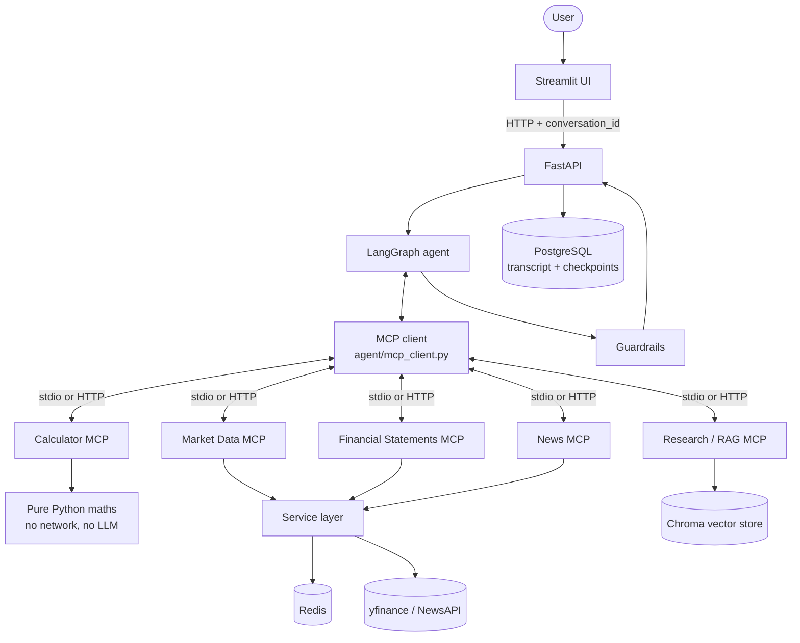
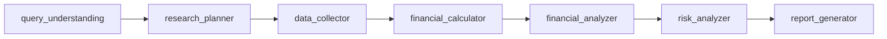
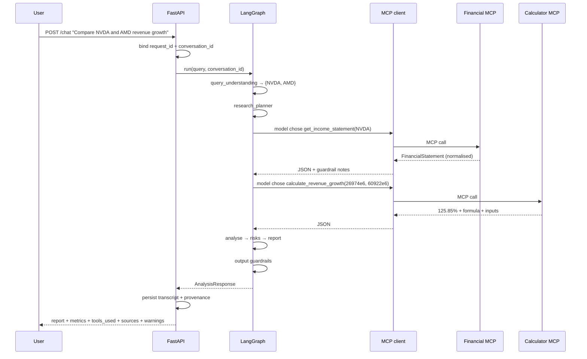

# Architecture

## The problem

A useful financial analyst has to do four things that a language model alone does badly:

1. **Get current data.** Models have a training cutoff. Stock prices and filings do not.
2. **Do arithmetic exactly.** A model asked for `(60922 - 26974) / 26974 * 100` will
   usually be close and occasionally wrong, and will not be wrong the same way twice.
3. **Cite what it used.** "Revenue grew strongly" is worthless without the figure, the
   period and the source.
4. **Say when it does not know.** The failure mode that matters in finance is a
   confident number that came from nowhere.

The architecture is organised around those four constraints.

## System diagram



## The agent workflow



The **sequence of stages is fixed** because research has a real order: you cannot
calculate before collecting, or analyse before calculating.

**Which tools get called is not fixed.** There is no keyword routing anywhere. Every tool
from every connected MCP server is bound to the model during the collection stage, and
the model chooses. `tests/test_agent_design.py` enforces this: it greps the graph source
for `if "stock" in query`-style routing and for any hardcoded tool name, and fails if one
appears.

Two stages have restricted tool sets — collection may not use the calculator, calculation
may not use data tools. That is a **permission boundary, not routing**: the model still
chooses freely within its set. Without it, the calculation stage could quietly fetch more
data and bypass the audit trail the collection stage builds.

| Node | Responsibility | Tools |
| --- | --- | --- |
| `query_understanding` | Identify companies and intent; resolve pronouns against history | none |
| `research_planner` | Decide what to gather and compute | none |
| `data_collector` | Gather figures | all non-calculator tools |
| `financial_calculator` | Compute every metric deterministically | calculator tools only |
| `financial_analyzer` | Interpret; label retrieved vs calculated vs interpretation | none |
| `risk_analyzer` | Identify risks, including gaps in the data | none |
| `report_generator` | Compose the 10-section report; run output guardrails | none |

## Layer responsibilities

| Layer | Owns | Must never |
| --- | --- | --- |
| Streamlit | Presentation, session history | Hold a credential, call MCP or a provider |
| FastAPI | HTTP contract, correlation ids, error mapping, persistence | Contain financial logic |
| LangGraph | Planning, tool selection, state, synthesis | Do arithmetic or call a provider |
| MCP client | Connection lifecycle, discovery, invocation, failure capture | Contain domain logic |
| FastMCP servers | Capability surface, validation, structured output | Know about the agent |
| Services | Provider calls, retries, caching, normalisation | Be called by the agent directly |
| Models | Domain types | Mirror a provider's schema |

Business logic lives in exactly one place. The clearest case: **all arithmetic happens in
the Calculator MCP**, in pure Python, and is never re-implemented in the graph or
performed by the model.

## Why MCP

Without MCP, tools are functions inside the agent process. That works until you have
twenty of them, and then:

- Everything shares one dependency set. `chromadb` pulls an 80MB ONNX model into the same
  process that serves an HTTP request needing none of it.
- One tool's bug takes down the agent.
- Tools cannot be scaled, restarted or rate-limited separately.
- Nothing else can use them.

MCP makes a tool a **protocol-level capability** instead of a function reference. The
agent discovers what exists at runtime rather than importing it. In this system, adding a
sixth server means adding one row to `_REGISTRY` in `agent/mcp_client.py` — the graph
does not change at all.

## Why five servers rather than one

Each server has a genuinely different shape:

| Server | Dependencies | Failure mode | Cache TTL |
| --- | --- | --- | --- |
| Calculator | none | cannot fail externally | n/a |
| Market | yfinance | rate limits, timeouts | 60s |
| Financial | yfinance | missing statements | 6h |
| News | NewsAPI / yfinance | empty results, quotas | 15m |
| Research | Chroma + embeddings | empty corpus | 1h |

A monolith would force the same deployment, dependency set, restart policy and rate-limit
budget on all five. Under Docker Compose they are five containers with independent
healthchecks, and the calculator — the one that must never be unavailable — has no
external dependency at all.

The separation is also what makes `/health` honest: a dead news server degrades the news
section of a report, not the whole answer.

## Transports: one protocol, three bindings

`MCPServerSpec` chooses how to reach a server:

| Mode | When | How |
| --- | --- | --- |
| stdio subprocess | local development | `python -m servers.<name>.server` |
| HTTP | Docker Compose | `<NAME>_MCP_URL=http://market-mcp:8002/mcp` |
| in-process | tests, single-process deploys | FastMCP in-memory transport |

Setting one environment variable per server switches the whole system from nine processes
to one, with no code change. It is also why the test suite is fast: tests use the
in-process transport so the provider can be mocked (a subprocess has its own `yfinance`
import, so patching in the parent would silently hit the live network — a bug this
project actually shipped and then fixed).

## Data flow for one question



## Provenance

Every number in a report can be traced:

```json
{
  "metric": "revenue_growth",
  "value": 125.85,
  "unit": "percent",
  "formula": "((current_revenue - previous_revenue) / previous_revenue) * 100",
  "inputs": {"previous_revenue": 26974000000.0, "current_revenue": 60922000000.0}
}
```

The report generator's output is then cross-checked: any number in the text that matches
no tool result is flagged (years and small counts excluded, rounded restatements
accepted). A figure the model invented does not pass silently.

## Failure philosophy

Every dependency degrades independently, and every degradation is **announced**:

| Failure | Effect | Where it is visible |
| --- | --- | --- |
| No `ANTHROPIC_API_KEY` | `/chat` returns 503; everything else works | `/health.agent_ready` |
| One MCP server down | Its tools are unavailable; others still run | `/health.failed_servers`, response `warnings` |
| Provider timeout / rate limit | That figure is unavailable | response `warnings`, tool_calls `ok: false` |
| PostgreSQL down | Analyses run, nothing is recorded; follow-ups only in-process | `/health.database_connected`, `checkpointer_backend` |
| Redis down | Slower, still correct | `/health.cache.backend` |
| Empty document corpus | "no such passage", not "the company did not say that" | `SearchResult.notes` |

The rule throughout: **a failure must reach the model as a readable message it can react
to, never as a silent empty result it might paper over.** A failed tool call returns JSON
containing `"guidance": "Do not invent the value it would have returned."`
